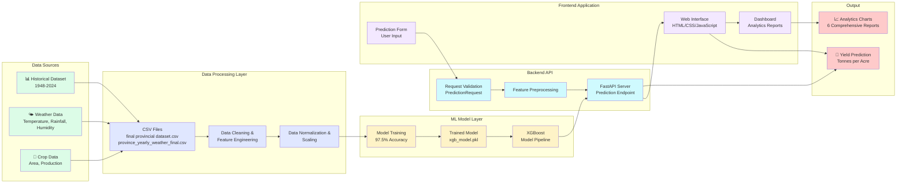
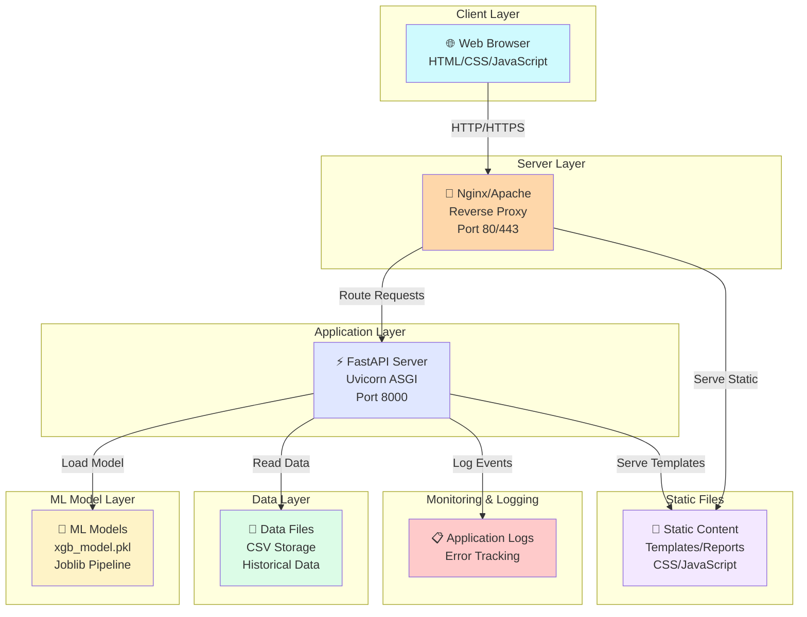
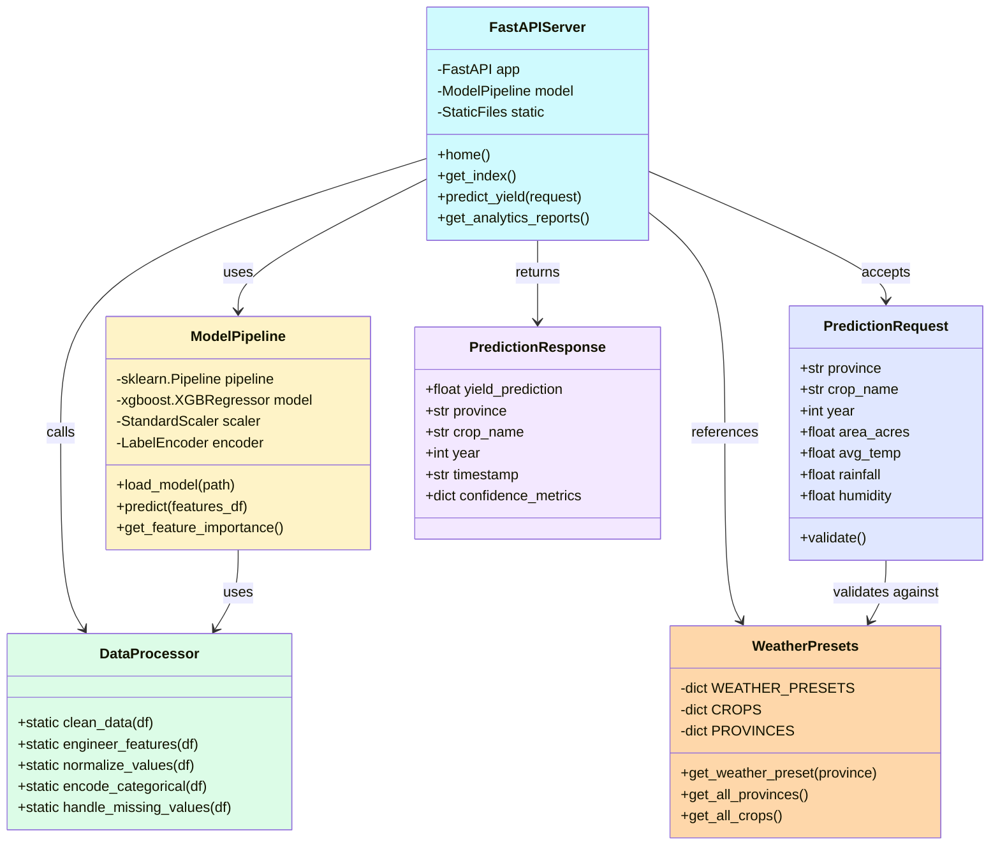
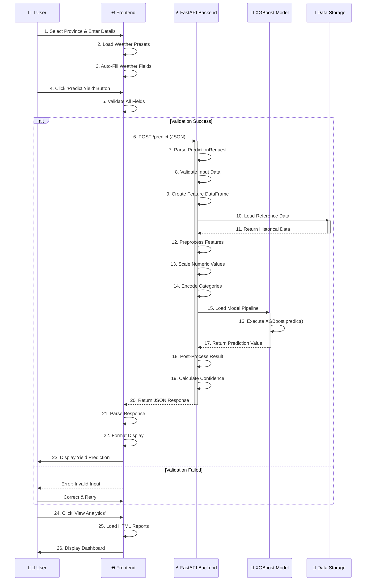
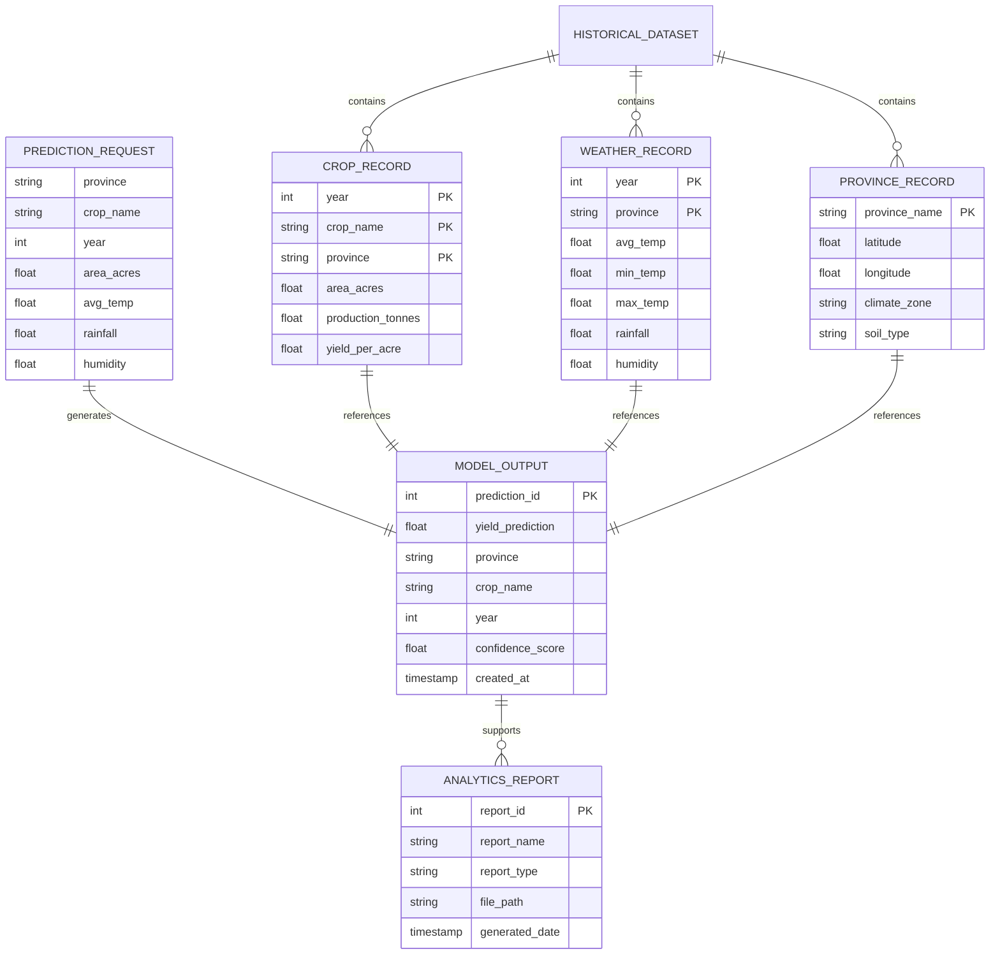
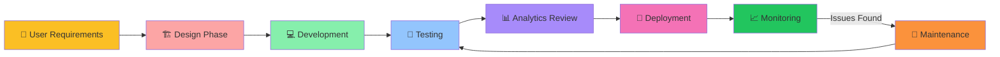

# AgriQuant - Software Engineering Diagrams

> Comprehensive system architecture and workflow diagrams for the AgriQuant Crop Yield Prediction System

---

## 1. Data Flow Diagram (DFD)

Shows how data flows through the entire system from collection to prediction output.



---

## 2. Deployment Diagram

Shows how the system components are deployed in production environment.



**Deployment Instructions:**
1. Install Python 3.8+
2. Set up virtual environment
3. Install dependencies: `pip install -r requirements.txt`
4. Run backend: `uvicorn backend.main:app --host 0.0.0.0 --port 8000`
5. Configure reverse proxy (Nginx) for port 80/443
6. Access via `http://yourserver.com`

---

## 3. Use Case Diagram

Shows interactions between users/actors and the system.

```mermaid
graph TB
    subgraph "AgriQuant System"
        UC1["Predict Crop Yield"]
        UC2["View Analytics Dashboard"]
        UC3["Load Weather Preset"]
        UC4["View Diagnostics Reports"]
        UC5["Compare Historical Data"]
        UC6["Export Predictions"]
        UC7["Validate Input Data"]
    end
    
    FARMER["👨‍🌾 Farmer"]
    PLANNER["📋 Agricultural Planner"]
    RESEARCHER["🔬 Researcher"]
    ADMIN["⚙️ System Admin"]
    
    FARMER -->|Get Yield Estimate| UC1
    FARMER -->|Fill Province Data| UC3
    FARMER -->|View Results| UC2
    
    PLANNER -->|Plan Production| UC1
    PLANNER -->|Analyze Trends| UC2
    PLANNER -->|Compare Data| UC5
    PLANNER -->|Export Report| UC6
    
    RESEARCHER -->|Study Patterns| UC2
    RESEARCHER -->|View Details| UC4
    RESEARCHER -->|Analyze Impact| UC5
    
    ADMIN -->|Monitor System| UC7
    ADMIN -->|Maintain Data| UC1
    
    style UC1 fill:#dcfce7
    style UC2 fill:#e0e7ff
    style UC3 fill:#fef3c7
    style UC4 fill:#fed7aa
    style UC5 fill:#cffafe
    style UC6 fill:#f3e8ff
    style UC7 fill:#fecaca
    
    style FARMER fill:#93c5fd
    style PLANNER fill:#86efac
    style RESEARCHER fill:#fbbf24
    style ADMIN fill:#f87171
```



**Actors & Use Cases:**
- **Farmer:** Primary user - gets predictions to optimize yield
- **Agricultural Planner:** Uses analytics for resource planning
- **Researcher:** Studies model performance and data trends
- **System Admin:** Maintains system and data integrity

---

## 4. Class Diagram

Shows the object-oriented structure and relationships in the backend.



---

## 5. Activity Diagram

Shows the workflow and activities performed in the prediction process.

```mermaid
activity
    start
    :User Opens Web Interface;
    :Display Home Tab with Introduction;
    :User Clicks 'Predict Yield' Button;
    :Show Prediction Form;
    :User Selects Province;
    :Load Weather Presets for Province;
    :Auto-Fill Weather Data Fields;
    :User Enters Crop Details;
    :User Enters Agricultural Parameters;
    
    if (All Fields Valid?) then
        :Send Request to FastAPI Server;
        :Backend Validates Input Data;
        :Create Feature DataFrame;
        :Load XGBoost Model Pipeline;
        :Execute Feature Preprocessing;
        :Scale Numeric Features;
        :Encode Categorical Variables;
        :Run Model Prediction;
        :Generate Confidence Metrics;
        :Return JSON Response;
        :Display Prediction Result;
        :Show Yield in Tonnes;
        :Display Statistics;
        :Offer Export Option;
    else (Form Invalid)
        :Show Error Messages;
        :Highlight Invalid Fields;
        :User Corrects Input;
    endif
    
    :User Views Analytics Dashboard;
    :Load 6 Pre-Generated Reports;
    :Display Interactive Charts;
    :User Can Download Reports;
    end
```

---

## 6. Sequence Diagram

Shows the interactions between frontend, backend, model, and data components over time.



---

## 7. Entity-Relationship Diagram (Data Structure)

Shows the data entities and their relationships (no database, file-based CSV storage).



**Data Files:**
- **final provincial dataset.csv:** Contains crop yield records (1948-2024) with columns: year, crop, province, area_acres, production_tonnes, yield_per_acre
- **province_yearly_weather_final.csv:** Contains weather data with columns: year, province, avg_temp, min_temp, max_temp, rainfall, humidity

---

## System Architecture Overview

### Technology Stack
- **Backend:** FastAPI (Python web framework)
- **ML Model:** XGBoost (gradient boosting regressor)
- **Data Processing:** Pandas, NumPy, Scikit-learn
- **Frontend:** HTML5, CSS3 (Tailwind), Vanilla JavaScript
- **Visualization:** Plotly, Matplotlib, Seaborn
- **Server:** Uvicorn (ASGI server)

### Key Components
1. **Data Layer:** CSV-based historical data (no database)
2. **ML Pipeline:** Scikit-learn Pipeline + XGBoost model
3. **API Layer:** FastAPI with CORS middleware
4. **Frontend:** Single-page application with multiple tabs
5. **Analytics:** 6 pre-generated HTML reports

### Data Flow Summary
```
Historical Data → Cleaning → Feature Engineering → Model Training
     ↓
Trained Model (pkl file)
     ↓
User Input → API Endpoint → Feature Preprocessing → Model.predict()
     ↓
Prediction Output → Frontend Display → Analytics Reports
```

### API Endpoints
- `GET /` - Health check
- `GET /index` - Serve main UI
- `POST /predict` - Make crop yield prediction
- `GET /static/...` - Serve static files and reports

---

## Deployment Architecture

```
┌─────────────────────────────────────────────────────┐
│            Production Environment                    │
├─────────────────────────────────────────────────────┤
│                                                       │
│  ┌──────────────────────────────────────────┐       │
│  │  Load Balancer (Optional)                │       │
│  │  Distributes traffic                     │       │
│  └─────────────┬──────────────────────────┘       │
│                │                                     │
│  ┌─────────────▼──────────────────────────────┐     │
│  │  Reverse Proxy (Nginx/Apache)              │     │
│  │  Port 80/443, SSL/TLS                      │     │
│  │  Caching, Compression                      │     │
│  └─────────────┬──────────────────────────────┘     │
│                │                                     │
│  ┌─────────────▼────────────────────────────────────┐ │
│  │  FastAPI Application Server                      │ │
│  │  Uvicorn (ASGI) - Port 8000                      │ │
│  │  ┌────────────────────────────────────────┐     │ │
│  │  │  FastAPI Routes                        │     │ │
│  │  │  CORS Middleware                       │     │ │
│  │  │  Static Files Mount                    │     │ │
│  │  └────────────────────────────────────────┘     │ │
│  └─────────────┬────────────────────────────────────┘ │
│                │                                      │
│  ┌─────────────▼────────────────────────────────────┐ │
│  │  ML Model Layer                                  │ │
│  │  XGBoost Pipeline (xgb_model.pkl)               │ │
│  │  Feature Preprocessing                          │ │
│  └─────────────┬────────────────────────────────────┘ │
│                │                                      │
│  ┌─────────────▼────────────────────────────────────┐ │
│  │  Data & Storage Layer                            │ │
│  │  CSV Files (Historical Data)                    │ │
│  │  Static Reports (HTML)                          │ │
│  │  Templates & Assets                             │ │
│  └────────────────────────────────────────────────┘ │
│                                                       │
│  ┌────────────────────────────────────────────────┐  │
│  │  Logging & Monitoring                           │  │
│  │  Application Logs, Error Tracking              │  │
│  │  Performance Metrics                           │  │
│  └────────────────────────────────────────────────┘  │
│                                                       │
└─────────────────────────────────────────────────────┘
```

---

## Quick Reference: How Each Component Works

### 1. **Frontend (Web UI)**
- Single HTML file with tab-based navigation
- Tabs: Home, Dashboard, Predict Yield
- Uses Tailwind CSS for styling
- JavaScript handles form submission and API calls
- Loads 6 analytics reports as iframes

### 2. **Backend API (FastAPI)**
- Validates incoming requests (PredictionRequest model)
- Creates feature DataFrame with required columns
- Applies preprocessing from model pipeline
- Executes XGBoost prediction
- Returns JSON response with prediction and metadata

### 3. **ML Model (XGBoost)**
- Trained on 76 years of historical data (1948-2024)
- Achieves 97.5% accuracy on test set
- Features: year, crop, province, area, temp, rainfall, humidity
- Outputs: Yield in tonnes per acre

### 4. **Data Processing**
- Loads CSV files: historical yields + weather data
- Cleans missing values
- Engineers features (temp ranges, ratios, etc.)
- Scales numeric values (StandardScaler)
- Encodes categorical variables (LabelEncoder)

### 5. **Analytics Reports**
- 6 pre-generated HTML/Plotly charts
- Interactive visualizations
- Loadable via frontend dashboard
- Include: diagnostics, distributions, feature importance, correlations

---

## Development Workflow



---

**Generated:** January 19, 2026  
**Project:** AgriQuant - Crop Yield Prediction Intelligence  
**Version:** 1.0  
**Status:** Production Ready
